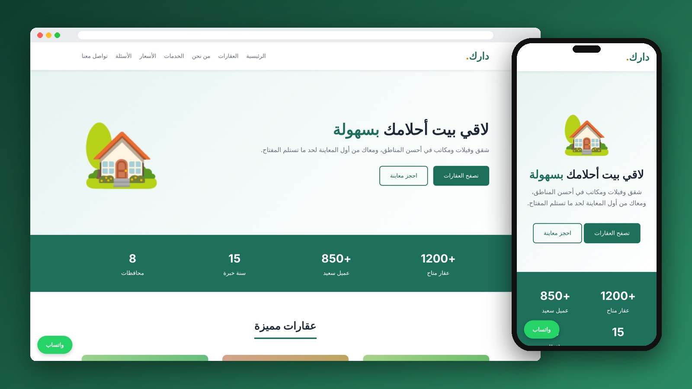

<div align="center">

# Darak Real Estate

An Arabic (RTL) landing page for a real estate company, built with plain HTML and CSS.

[](https://mo7-adad.github.io/darak-real-estate/)

   

</div>

---



## Features

- Right-to-left Arabic layout
- Featured property cards for sale and rent
- Stats, about, services, prices table and reviews sections
- FAQ built with native `details` / `summary`
- Contact form with built-in HTML validation
- Fully responsive for desktop, tablet and mobile

## Project Structure

```
darak-real-estate/
├── index.html
└── style.css
```

## Run Locally

```bash
git clone https://github.com/mo7-adad/darak-real-estate.git
cd darak-real-estate
```

Then open `index.html` in your browser, or right-click it in VS Code and choose **Open with Live Server**.

## Author

**Mohamed Al-hadad** — Front-End Developer

[](https://github.com/mo7-adad)
